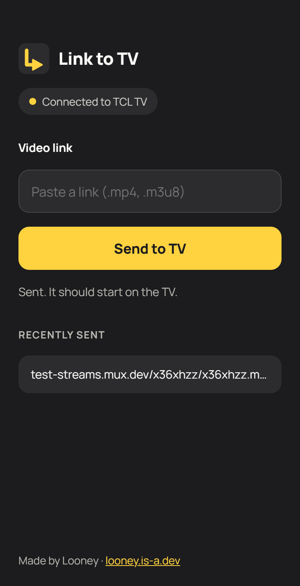

<h1 align="center">Link to TV</h1>

Send a video link, or a file, from your iPhone to your Android TV. It plays in VLC. 
No app on the phone, no account, no cloud.

| TV screen | iPhone page |
|---|---|
|  |  |

## Features
- **Nothing to install on the phone.** The TV hosts a small web page. Scan the QR code and send.
- **Pair once.** A 6-digit code on the TV pairs your phone. Remove phones from **Paired devices** on the TV.
- **Plays almost anything.** Links open in VLC, so `.mkv`, `.mp4`, `.m3u8` and more work.
- **History and favourites** on the page, so you can replay links in one tap.
- **Queue.** Build a list and play it all in VLC.
- **Send files.** Upload photos and videos from the phone to the TV.
- **Share menu.** Add an iOS Shortcut so Safari's Share button has Send to TV.
- Open source, no ads, no tracking.

## Install
1. Build the APK. Push this repo to GitHub: the workflow in `.github/workflows` builds `app-debug.apk` (Actions > latest run > Artifacts). Or open the folder in Android Studio.
2. Sideload `app-debug.apk` onto your Android TV or Google TV (USB stick, or Send Files to TV).
3. Install **VLC** from the Play Store on the TV.

## Use
1. Open **Link to TV** on the TV. It shows an address, a QR code and a pairing code.
2. On your iPhone (same Wi-Fi), scan the QR code or open the address in Safari.
3. Enter the pairing code once.
4. Paste a direct video link and tap **Send to TV**.

### iPhone Share menu (optional)
On the iPhone page, open **Share menu setup**. It shows the address and token to use in a Shortcut:
1. Shortcuts app > **+**, name it *Send to TV*, turn on **Show in Share Sheet** (URLs).
2. Add **Get Contents of URL**: URL = the address from the page, Method = POST, Request Body = Form.
3. Add a Text field `url` = *Shortcut Input*, and a header `X-Token` = the token from the page.

Reserve the TV's IP address in your router so the address does not change.

## Limits
- Phone and TV must be on the same Wi-Fi.
- Links must be direct media URLs, not web pages such as YouTube.
- Uploaded files are kept on the TV only briefly (the latest three). Photos open in the TV's default viewer, which varies by model.
- Seeking in uploaded videos may be limited.
- This project is a scaffold built without automated tests: expect small fixes.

## Responsible use
Link to TV only passes links to VLC. Only send content you have the right to watch.

---
Made by **Looney** · [looney.is-a.dev](https://looney.is-a.dev)
